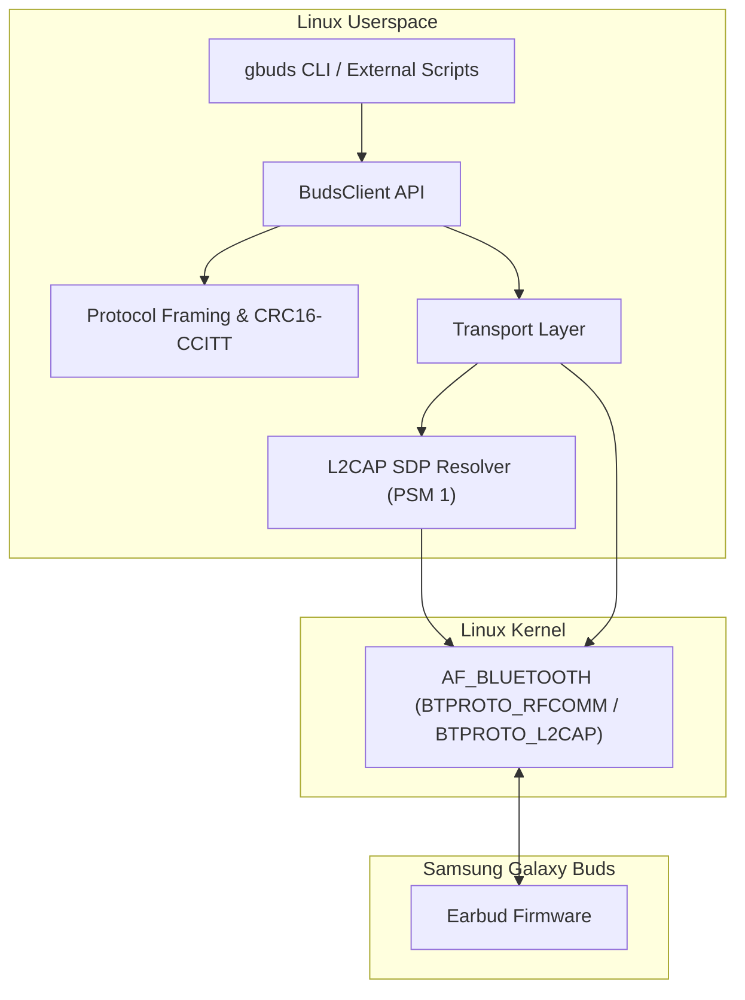
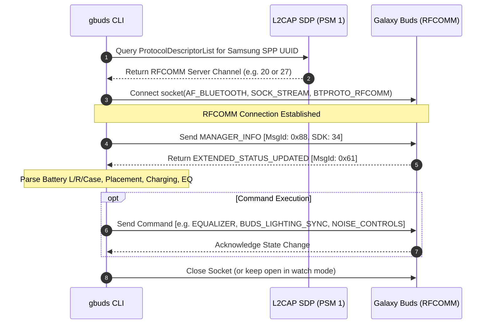

# gbuds

A lightweight, headless command-line interface and Python library for controlling Samsung Galaxy Buds on Linux systems without graphical dependencies.

Designed for headless environments, automation scripts, and integration into Linux desktop status bars such as Waybar, Polybar, Eww, and DMS/QuickShell.

---

## Overview

`gbuds` communicates directly with Samsung Galaxy Buds over the Bluetooth Serial Port Profile (SPP) and RFCOMM protocol. It implements binary packet framing, CRC16-CCITT checksum validation, dynamic SDP service discovery over L2CAP, and message decoding required to inspect and control the earbuds natively on Linux.

### Key Capabilities

- Telemetry and Placement: Real-time battery levels for left earbud, right earbud, and charging case, charging states, and wearing/placement status (in-ear, idle, in-case).
- Noise Control: Switch between Active Noise Cancellation (ANC), Ambient Sound, Normal (Off), and Adaptive mode.
- Sound Equalizer: Switch between official hardware EQ profiles (Normal/Off, Bass Boost, Soft, Dynamic, Clear, Treble Boost).
- Stem Blade Lights (Buds 3 / Buds 3 Pro): Control stem LED light strips (Off, Steady, Fade, Blink).
- Find My Earbuds: Trigger acoustic locator beeping on left, right, or both earbuds.
- Voice Detect: Toggle automatic conversation detection and ambient auto-pause.
- Ambient Volume: Control ambient sound amplification level (0 to 4).
- Continuous Event Stream (`watch`): Stream newline-delimited JSON events on state changes without reconnecting the socket every query.
- BlueZ Connection Control: Direct connect and disconnect via BlueZ D-Bus without external tools.
- Touchpad Control: Lock or unlock touch gesture controls on both earbuds.
- Hardware Inspection: Auto-detection of device model (e.g., SM-R530, SM-R630), color variant, firmware revision, and serial numbers.
- Dual Linux Transport: Direct kernel socket transport using `AF_BLUETOOTH` with integrated L2CAP SDP channel resolver, or BlueZ D-Bus Profile1 client.
- Structured JSON Output: `--json` flag on all commands for integration with desktop widgets and shell pipelines.

---

## Supported Devices

- Samsung Galaxy Buds3 / Buds3 Pro (SM-R530, SM-R630)
- Samsung Galaxy Buds2 / Buds2 Pro (SM-R177, SM-R510)
- Samsung Galaxy Buds FE (SM-R400N)
- Samsung Galaxy Buds Live (SM-R180)
- Samsung Galaxy Buds Pro (SM-R190)
- Samsung Galaxy Buds+ (SM-R175)
- Samsung Galaxy Buds 2019 (SM-R170)

---

## Architecture and Protocol Flow

### System Architecture



### Communication Sequence



---

## Packet Structure

Messages adhere to the Samsung SPP RFCOMM binary framing:

| Field | Size | Description |
| :--- | :--- | :--- |
| **SOM (Start of Message)** | 1 byte | `0xFD` (Modern) / `0xFE` (Legacy 2019) / `0xFC` (SMEP) |
| **Header** | 2 bytes | UInt16 Little-Endian: Bits 0-9 body size, Bit 12 Response flag |
| **MsgId** | 1 byte | SPP Message Identifier |
| **Payload** | N bytes | Message data (`BodySize - 3` bytes) |
| **CRC16-CCITT** | 2 bytes | Little-Endian over `[MsgId] + Payload` (Poly `0x1021`, Init `0x0000`) |
| **EOM (End of Message)** | 1 byte | `0xDD` (Modern) / `0xEE` (Legacy 2019) / `0xCC` (SMEP) |

---

## Installation

### Using pipx (Recommended)

To install globally in an isolated environment:

```bash
pipx install git+https://github.com/JessVolet/gbuds-cli.git
```

Or from a local clone:

```bash
git clone https://github.com/JessVolet/gbuds-cli.git
cd gbuds-cli
pipx install .
```

### Using pip

```bash
pip install --user .
```

### Running Directly from Source

No installation is strictly necessary:

```bash
git clone https://github.com/JessVolet/gbuds-cli.git
cd gbuds-cli
./gbuds --help
```

---

## Command Reference

### Global Options

- `--mac MAC`: Specify target device Bluetooth address. If omitted, `gbuds` automatically detects paired Galaxy Buds via BlueZ D-Bus, prioritizing active connections.
- `--json`: Format command output as structured JSON. Can be specified before or after any subcommand.
- `--transport {direct,bluez}`: Choose transport backend. Default is `direct`.
- `--channel CHANNEL`: Manually override the RFCOMM channel number.

---

### Summary of Subcommands

| Subcommand | Arguments | Description |
| :--- | :--- | :--- |
| `info` | None | Displays model metadata, color, firmware, and telemetry |
| `battery` | None | Queries battery percentages and in-ear placement status |
| `anc` | `on`, `off`, `ambient`, `adaptive`, `toggle` | Controls noise cancellation and ambient modes |
| `eq` | `normal`, `bass`, `soft`, `dynamic`, `clear`, `treble` | Sets or queries sound equalizer profile |
| `lights` | `off`, `steady`, `fade`, `blink` | Controls stem LED blade lights (Buds 3 / Buds 3 Pro) |
| `find` | `left`, `right`, `both`, `stop` | Makes earbuds ring to locate them |
| `ambient-volume` | `0` to `4` | Sets ambient sound amplification level |
| `voice-detect` | `on`, `off` | Toggles conversation detect auto-pause |
| `touchpad` | `lock`, `unlock` | Locks or unlocks touch controls |
| `watch` | `--interval SEC` | Streams continuous telemetry updates for widgets |
| `connect` | None | Connects device via BlueZ Bluetooth |
| `disconnect` | None | Disconnects device via BlueZ Bluetooth |

---

### Examples

#### 1. Device Info

```bash
gbuds info
gbuds info --json
```

#### 2. Battery and Placement Status

```bash
gbuds battery
```

Output:

```text
=== Galaxy Buds Battery & Placement ===
- Left earbud:     88% [Wearing]
- Right earbud:    86% [Wearing]
- Case:            N/A (Buds out of case or closed)
- Noise Control:   NOISE_REDUCTION
- Equalizer:       DYNAMIC
- Touchpad:        Unlocked
```

JSON output:

```json
{
  "success": true,
  "battery": {
    "left": 88,
    "right": 86,
    "case": null,
    "left_charging": false,
    "right_charging": false,
    "case_charging": false,
    "is_coupled": true
  },
  "placement": {
    "left": "WEARING",
    "right": "WEARING"
  },
  "noise_control": "NOISE_REDUCTION",
  "equalizer": "DYNAMIC",
  "touchpad_locked": false
}
```

#### 3. Noise Cancellation (ANC)

```bash
gbuds anc toggle
gbuds anc on
gbuds anc off
gbuds anc ambient
gbuds anc adaptive
```

#### 4. Equalizer Profiles

```bash
# Query current preset
gbuds eq

# Set profile
gbuds eq dynamic
gbuds eq bass
gbuds eq clear
gbuds eq normal
```

#### 5. Blade Lights (Buds 3 / Buds 3 Pro)

```bash
gbuds lights steady
gbuds lights fade
gbuds lights blink
gbuds lights off
```

#### 6. Find My Earbuds

```bash
gbuds find both
gbuds find left
gbuds find right
gbuds find stop
```

#### 7. Continuous Telemetry Stream (`watch`)

Keeps the connection open and streams newline-delimited JSON events whenever a parameter changes (battery, in-ear placement, equalizer, ANC mode):

```bash
gbuds watch --json
```

Streaming JSON output:

```json
{"left": 88, "right": 86, "case": 0, "left_charging": false, "right_charging": false, "case_charging": false, "is_coupled": true, "placement_left": "WEARING", "placement_right": "WEARING", "noise_control": "NOISE_REDUCTION", "equalizer": "DYNAMIC", "ambient_volume": null, "voice_detect": null, "blade_lights": null, "touchpad_locked": false}
```

#### 8. Bluetooth Connect / Disconnect

Connect or disconnect the device via host BlueZ without shell subshells:

```bash
gbuds connect
gbuds disconnect
```

---

## Status Bar Integration Example (Waybar)

### Polling Mode

```json
"custom/gbuds": {
    "format": "Buds: L:{}% R:{}%",
    "exec": "gbuds battery --json",
    "return-type": "json",
    "interval": 30,
    "on-click": "gbuds anc toggle"
}
```

### Continuous Stream Mode (Zero Reconnection Overhead)

```json
"custom/gbuds": {
    "format": "Buds: L:{left}% R:{right}%",
    "exec": "gbuds watch --json",
    "return-type": "json",
    "on-click": "gbuds anc toggle"
}
```

---

## Acknowledgements

This project was built using the reverse engineering findings and protocol documentation established by:

- **[GalaxyBudsClient](https://github.com/timschneeb/GalaxyBudsClient)** by **Tim Schneeberger ([@timschneeb](https://github.com/timschneeb))**: The foundational reference and implementation guide for Samsung SPP packet framing, CRC16-CCITT calculations, message definitions, and decoding routines.

---

## AI Disclosure

This codebase was designed and developed with the assistance of artificial intelligence (Antigravity by Google DeepMind) in pair-programming collaboration with the project maintainer.

---

## License

This project is licensed under the MIT License. See the [LICENSE](LICENSE) file for details.
