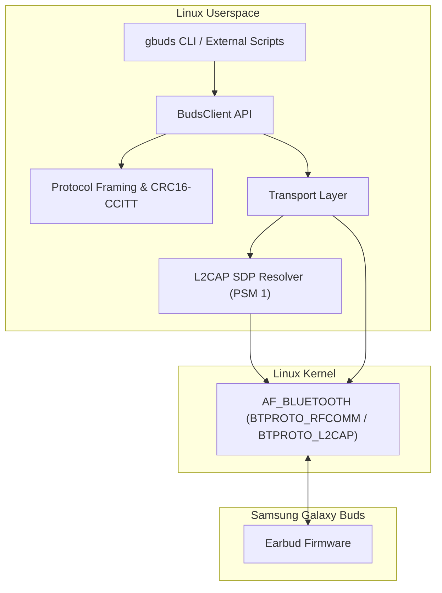
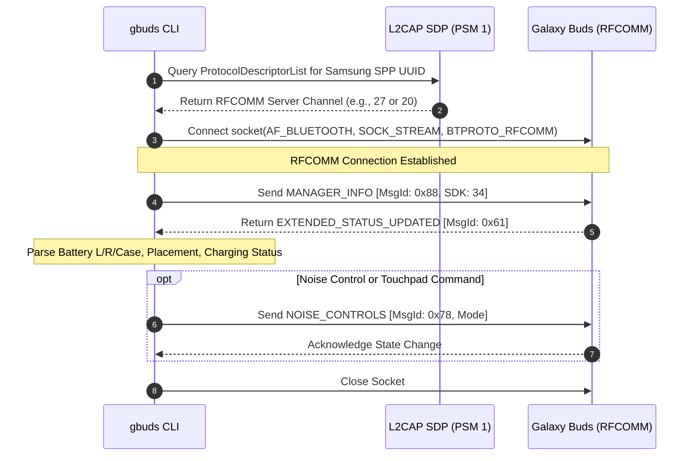

# gbuds

A lightweight, headless command-line interface and Python library for controlling Samsung Galaxy Buds on Linux systems without graphical dependencies.

Designed for headless servers, automation scripts, and integration into Linux desktop status bars such as Waybar, Polybar, Eww, and DMS/QuickShell.

---

## Overview

`gbuds` communicates directly with Samsung Galaxy Buds over the Bluetooth Serial Port Profile (SPP) and RFCOMM protocol. It implements the binary packet framing, CRC16-CCITT checksum calculation, dynamic SDP service discovery, and message decoding required to inspect and control the earbuds natively on Linux.

### Key Capabilities

- Battery telemetry: Real-time battery levels for left earbud, right earbud, and charging case, including charging states.
- Noise control: Switch between Active Noise Cancellation (ANC), Ambient Sound, Normal (Off), and Adaptive mode.
- Touchpad control: Lock or unlock touch gesture controls on both earbuds.
- Hardware inspection: Auto-detection of device model (e.g., SM-R530, SM-R630), color variant, firmware revision, and serial numbers.
- Dual Linux transport:
  - Direct kernel socket transport using `AF_BLUETOOTH` with integrated pure-Python SDP channel discovery over L2CAP.
  - BlueZ D-Bus Profile1 client with file descriptor passing.
- Structured JSON output: `--json` flag on all commands for seamless integration with status bars and background daemons.

---

## Supported Devices

- Samsung Galaxy Buds3 / Buds3 Pro (SM-R530, SM-R630)
- Samsung Galaxy Buds2 / Buds2 Pro (SM-R177, SM-R510)
- Samsung Galaxy Buds FE (SM-R400N)
- Samsung Galaxy Buds Live (SM-R180)
- Samsung Galaxy Buds Pro (SM-R190)
- Samsung Galaxy Buds+ (SM-R175)
- Samsung Galaxy Buds 2019 (SM-R170)

---

## Architecture and Protocol Flow

### System Architecture



### Communication Sequence



---

## Packet Structure

Messages adhere to the Samsung SPP RFCOMM binary framing:

| Field | Size | Description |
| :--- | :--- | :--- |
| **SOM (Start of Message)** | 1 byte | `0xFD` (Modern) / `0xFE` (Legacy 2019) / `0xFC` (SMEP) |
| **Header** | 2 bytes | UInt16 Little-Endian: Bits 0-9 body size, Bit 12 Response flag |
| **MsgId** | 1 byte | SPP Message Identifier |
| **Payload** | N bytes | Message data (`BodySize - 3` bytes) |
| **CRC16-CCITT** | 2 bytes | Little-Endian over `[MsgId] + Payload` (Poly `0x1021`, Init `0x0000`) |
| **EOM (End of Message)** | 1 byte | `0xDD` (Modern) / `0xEE` (Legacy 2019) / `0xCC` (SMEP) |

---

## Installation

### Using pipx (Recommended)

To install globally in an isolated environment:

```bash
pipx install git+https://github.com/JessVolet/gbuds-cli.git
```

Or from a local clone:

```bash
git clone https://github.com/JessVolet/gbuds-cli.git
cd gbuds-cli
pipx install .
```

### Using pip

```bash
pip install --user .
```

### Running Directly from Source

No installation is strictly necessary:

```bash
git clone https://github.com/JessVolet/gbuds-cli.git
cd gbuds-cli
./gbuds --help
```

---

## Command Reference

### Global Options

- `--mac MAC`: Specify target device Bluetooth address. If omitted, `gbuds` automatically detects paired Galaxy Buds via BlueZ D-Bus.
- `--json`: Format command output as structured JSON.
- `--transport {direct,bluez}`: Choose transport backend. Default is `direct`.
- `--channel CHANNEL`: Manually override the RFCOMM channel number.

---

### 1. `info`

Displays device model, marketing color, MAC address, connection state, firmware revision, and hardware serial numbers.

```bash
gbuds info
```

Output:

```text
========================================
Device:            Buds3 de Jose
Model:             Galaxy Buds3 (SM-R530)
Color:             Silver
MAC Address:       24:24:B7:DD:38:90
Bluetooth Link:    Connected
Supports ANC:      Yes
Supports Adaptive: Yes
Firmware Version:  R530XXU0AZD2
----------------------------------------
- Battery Left:    97%
- Battery Right:   96%
- Noise Control:   OFF
- Touchpad:        Locked
========================================
```

JSON output:

```bash
gbuds --json info
```

```json
{
  "success": true,
  "connected": true,
  "device": {
    "name": "Buds3 de Jose",
    "model": "Galaxy Buds3",
    "model_code": "SM-R530",
    "color": "Silver",
    "mac_address": "24:24:B7:DD:38:90",
    "connected": true,
    "supports_anc": true,
    "supports_adaptive": true,
    "firmware_version": "R530XXU0AZD2",
    "cradle_serial": null,
    "left_serial": null,
    "right_serial": null
  },
  "battery": {
    "left": 97,
    "right": 96,
    "case": null,
    "left_charging": false,
    "right_charging": false,
    "case_charging": false,
    "is_coupled": true
  },
  "noise_control": "OFF",
  "touchpad_locked": true
}
```

---

### 2. `battery`

Queries battery percentages for the left earbud, right earbud, and case.

```bash
gbuds battery
```

JSON output:

```bash
gbuds --json battery
```

```json
{
  "success": true,
  "battery": {
    "left": 96,
    "right": 96,
    "case": null,
    "left_charging": false,
    "right_charging": false,
    "case_charging": false,
    "is_coupled": true
  },
  "noise_control": "OFF",
  "touchpad_locked": true
}
```

---

### 3. `anc`

Controls Active Noise Cancellation and ambient listening modes.

```bash
# Toggle between ANC and Normal (Off)
gbuds anc toggle

# Set specific modes
gbuds anc on        # Enable Active Noise Cancellation
gbuds anc off       # Disable ANC (Normal mode)
gbuds anc ambient   # Enable Ambient Sound mode
gbuds anc adaptive  # Enable Adaptive mode (Buds3 / Buds3 Pro)
```

JSON output:

```bash
gbuds --json anc on
```

```json
{
  "success": true,
  "action": "on",
  "noise_control": "NOISE_REDUCTION"
}
```

---

### 4. `touchpad`

Locks or unlocks the touchpads to prevent accidental touches.

```bash
gbuds touchpad lock
gbuds touchpad unlock
```

JSON output:

```bash
gbuds --json touchpad lock
```

```json
{
  "success": true,
  "action": "lock",
  "touchpad_locked": true
}
```

---

## Status Bar Integration Example (Waybar)

Add a custom module to your Waybar configuration:

```json
"custom/gbuds": {
    "format": "Buds: L:{}% R:{}%",
    "exec": "gbuds --json battery",
    "return-type": "json",
    "interval": 30,
    "on-click": "gbuds anc toggle"
}
```

---

## Acknowledgements

This project was built using the reverse engineering findings and protocol documentation established by:

- **[GalaxyBudsClient](https://github.com/timschneeb/GalaxyBudsClient)** by **Tim Schneeberger ([@timschneeb](https://github.com/timschneeb))**: The foundational reference and implementation guide for Samsung SPP packet framing, CRC16-CCITT calculations, message definitions, and decoding routines.

---

## AI Disclosure

This codebase was designed and developed with the assistance of artificial intelligence (Antigravity by Google DeepMind) in pair-programming collaboration with the project maintainer.

---

## License

This project is licensed under the MIT License. See the [LICENSE](LICENSE) file for details.
