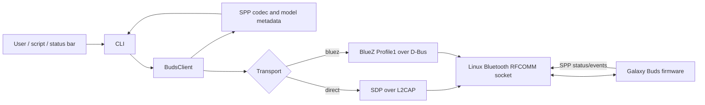
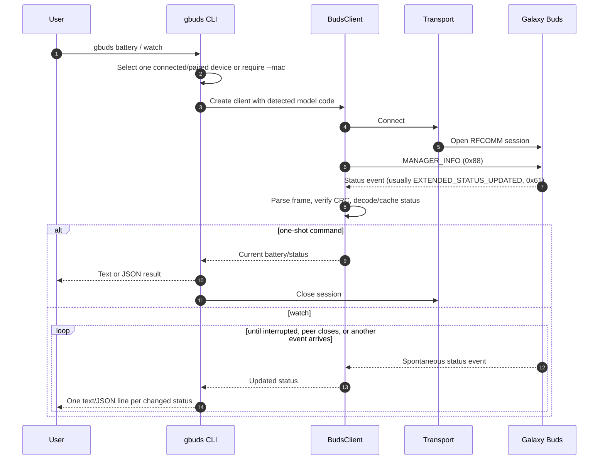

# Architecture

Gbuds is a small Python package with a CLI boundary, a protocol/client layer, and interchangeable Linux Bluetooth transports. The transport passes raw RFCOMM bytes; packet framing, message interpretation, and model capability checks live above it.

## Components

| Component | Responsibility |
| --- | --- |
| `src/gbuds/cli.py` | Parse commands/options, select a device, enforce model capability gates, and format text or JSON. |
| `src/gbuds/client.py` | Own an RFCOMM session, perform the manager handshake, process incoming messages, cache status, and expose control/query methods. |
| `src/gbuds/protocol.py` | Define message IDs/enums, build and parse modern SPP packets, validate CRC16-CCITT, decode status, and encode supported commands. |
| `src/gbuds/models.py` | Map Samsung device IDs/names to model codes and declared capabilities. |
| `src/gbuds/transport.py` | Implement direct kernel RFCOMM and optional BlueZ Profile1 transports. |
| `src/gbuds/sdp.py` | Encode/decode the subset of SDP needed to discover RFCOMM service channels. |

## System view

## Connection and status flow

`watch` is passive after the initial manager handshake. It does not periodically send a status event ID as a poll request. See [Protocol notes](PROTOCOL.md) for framing and model coverage boundaries.

## Transport selection

- **`direct`** (default): uses Linux `AF_BLUETOOTH` RFCOMM sockets and queries SDP over L2CAP to find Samsung service channels. It can try alternate discovered/fallback channels when a channel is occupied.
- **`bluez`**: registers a client Profile1 service with BlueZ, requests the device profile connection, and reads/writes the RFCOMM file descriptor BlueZ supplies. It requires Python D-Bus and GLib bindings.

An external process may already hold one SPP channel. Gbuds can report the busy channel and use another discovered channel. This does not mean Gbuds controls or owns the external daemon.
